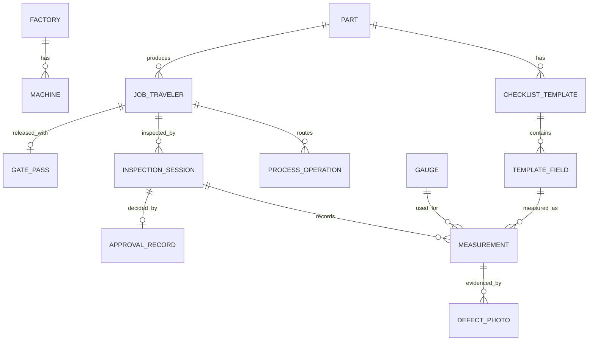

# Factory QC: Factory Operations & Quality Control System

A Django implementation of the core of the Zapuza Technologies BRD: a digital quality-control system where **a job cannot move forward unless every check is complete and verified**. Instead of paper forms, the system enforces locks: expired gauges are refused, failed measurements need photo evidence, critical failures cannot be waived, operations must run in order, and nothing ships until it is fully cleared.

> **Demo video (voice narration):** [Watch the walkthrough](https://drive.google.com/file/d/1UnJxBA7dHoAOyZBRH3XFb9EaAtqetenv/view?usp=sharing)

Built with **Python 3.12 and Django 6.1 only** (SQLite, no JavaScript framework, no external services).

---

## What is implemented

| Area | BRD reference | What it does |
|---|---|---|
| Roles & permissions | 12.1 | Custom `User` with six roles. Views and services enforce who may inspect, approve and release. |
| Master data | 2.1 | Factory, Part, Machine, Gauge registers (managed in Django admin). |
| Gauge calibration lock | 2.3 | A measurement needs a gauge. Expired or inactive gauges are refused with a clear message. |
| Checklist templates | 4.1, 4.3 | Templates per part with revision, field types (dimension ± tolerance, max/min threshold, visual pass/fail) and a **CTQ** flag. |
| Automatic pass/fail | 5.4 | Every measurement is judged against its tolerance the moment it is saved. |
| Inspector workflow | 5.1 | Locked checklist: every required field must be filled, and the submit is refused otherwise. Only the assigned inspector can submit. |
| Defect photo rule | 5.4 | A failed measurement needs **at least 2 photos** before the inspection can be submitted. |
| Supervisor review | 6.1, 6.2 | Queue of submitted inspections. Decisions: Approve, Conditional Concession, Reject. |
| CTQ protection | 4.3, 6.2 | A failed inspection can never be plainly approved. A CTQ failure can never get a concession. Only rejection is allowed. |
| Job travelers & routing | 7.1 | Digital traveler with ordered operations (Op 10, 20, 30...). |
| Step-order lock | 7.1 | An operation cannot start until all earlier operations are completed. |
| Shipping interlock | 10.1, 10.2 | A gate pass is released only if the traveler has operations, all are completed, and the **latest** inspection is approved or conceded. The error names the exact unmet requirement. |

All business rules live in **service functions** (`inspections/services.py`, `travelers/services.py`) and in the model methods they call. Views stay thin, and every rule can be tested without a browser.

## What is not implemented (future scope)

I focused on building fewer features reliably, as the assessment brief allowed. These BRD items are **not** built:

- Raw material intake, MTC upload and supplier quarantine / SNCR (BRD section 3)
- Immutable audit trail (13.3)
- Hold-time timers between operations (section 8)
- Material Review Board dispositions, quarantine blocking downstream work (6.3)
- Template approval workflow (status field only) and blueprint pinning
- Heat-number traceability search, QR labels, public customer report page
- Shift handover log, first-piece and hourly inspection prompts, offline mode

`Machine.is_pm_overdue()` exists as a model helper for the daily-PM lock, but it is not yet enforced in a workflow.

---

## Tech stack

- Python 3.12, Django 6.1.2
- SQLite (zero-configuration for reviewers)
- Pillow (defect photo uploads)
- Server-rendered Django templates, no front-end framework

## Setup

```bash
# 1. Clone
git clone https://github.com/faizurrehman-mirza/factory_qc.git
cd factory_qc

# 2. Create and activate a virtual environment
python -m venv venv
venv\Scripts\activate          # Windows
# source venv/bin/activate     # macOS / Linux

# 3. Install dependencies
pip install -r requirements.txt

# 4. Create the database and load demo data
python manage.py migrate
python manage.py load_sample_data

# 5. Run
python manage.py runserver
```

Open http://127.0.0.1:8000/.

### Demo accounts (created by `load_sample_data`)

| Username | Role | Password |
|---|---|---|
| `inspector` | QA Floor Inspector | `Test@1234` |
| `supervisor` | Shift Supervisor | `Test@1234` |
| `quality_manager` | Quality Manager | `Test@1234` |
| `quality_engineer` | Quality Engineer | `Test@1234` |
| `admin` | Plant Manager / superuser | `Admin@1234` |

These are demo credentials for local use only.

### Demo data

- Parts: `SHAFT-25MM`, `GEAR-A12`, `HOUSING-CAST`
- Gauges: `VC-104` (valid), `MM-12` (valid), **`VC-099` (calibration expired)**
- Traveler **`JT-2026-001`** (shaft) with an active checklist:
  1. Shaft Outer Diameter: 25.000 mm, +0.050 / -0.020, **CTQ**
  2. Surface Roughness: Ra 0.8 max
  3. Visual: free of burrs
- Its operations start as Op 10 completed, Op 20 in progress, Op 30 pending.

## Where to go in the app

| URL | Who | Purpose |
|---|---|---|
| `/` | everyone | Sign in, then redirected by role |
| `/inspections/` | Inspector | Start an inspection, resume one in progress |
| `/inspections/<id>/` | Inspector | Fill the checklist with live validation and photo upload |
| `/inspections/approvals/` | Supervisor / QM / Plant Manager | Review queue and decisions |
| `/shipping/gate-passes/` | Supervisor / QM / Plant Manager | Release a gate pass |
| `/admin/` | Admin | Master data, templates, travelers. Operations are started and completed from the **Process operations** admin actions |

## Running the tests

```bash
python manage.py test
```

32 tests, all passing. They cover:

- **Gauge rules:** expired gauge blocked, gauge required for measured fields, visual checks need no gauge, an existing measurement can still be saved after its gauge later expires
- **Submit rules:** missing required fields, failed measurement with 0 or 1 photo is refused and 2 photos is accepted, another inspector cannot submit or open the session
- **Approval rules:** inspector cannot approve, a failed inspection cannot be approved, a CTQ failure cannot get a concession, an invalid decision creates no record, supervisor can approve a passing inspection
- **Operation order:** a later operation cannot start before the earlier one is completed, an operation must be started before it is completed, an on-hold traveler cannot start work, traveler status follows the operations
- **Gate pass interlock:** at least one operation is required, the latest inspection must be approved or conceded, release succeeds when everything is cleared, and the gate pass screen shows the blocking reason
- **Role redirects:** inspector and supervisor land on the right page after sign-in

## Project structure

```
config/        settings, root URLs
accounts/      custom User and roles, role-based workbench redirect
masters/       Factory, Part, Machine, Gauge + load_sample_data command
inspections/   templates, sessions, measurements, photos, approvals
               services.py = validate_gauge, submit_inspection, decide_approval
travelers/     JobTraveler, ProcessOperation
               services.py = start_operation, complete_operation
shipping/      GatePass with the release interlock
templates/     base layout, login, inspector, approval and gate pass pages
```

## Data model



## Design decisions

- **Rules in services, not views.** Views only translate HTTP to a service call and show the `ValidationError`. The same rules therefore apply from the UI, admin actions and tests.
- **Tolerances are entered as positive magnitudes.** For nominal 25.000 with upper 0.050 and lower 0.020, the accepted range is 24.980 to 25.050, inclusive at both ends.
- **Gauge rules apply when a measurement is first recorded.** An old measurement stays editable if its gauge expires later, because history must not break.
- **Only the latest inspection counts for shipping.** An old approval cannot hide a newer rejection.
- **Pass/fail is computed, never typed.** `Measurement.save()` recalculates the result so it cannot be forged from the form.
- **Transactions.** Approval creation and the status change happen atomically, and operation changes lock the rows they touch.

## Known limitations

- `SECRET_KEY` and `DEBUG` are development values. Do not deploy as is.
- Uploaded photos are stored under `media/` and served by Django only when `DEBUG=True`.
- Gauge selection is a dropdown, not a barcode scan, and there is no camera capture.
- Operations are started and completed from Django admin actions, not a dedicated operator screen.

## Author

Faizurrehman Mirza